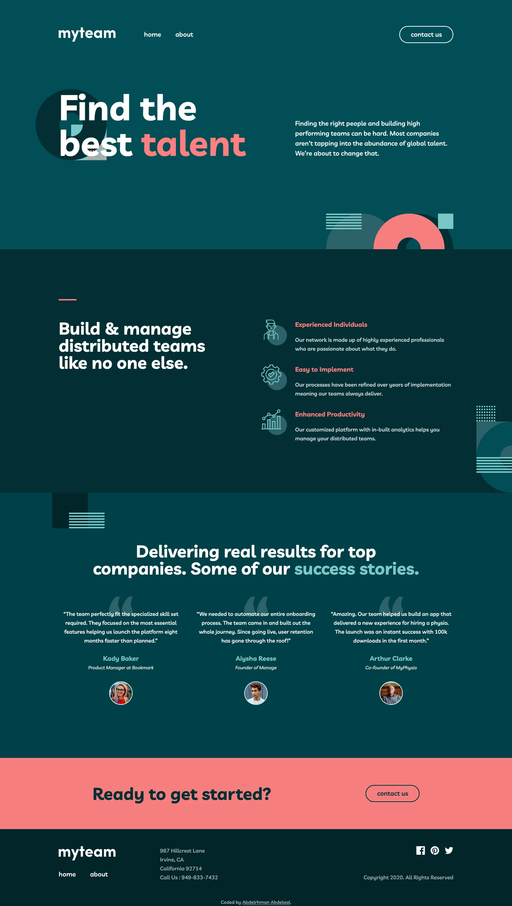

# myteam multi-page website

My solution to the [myteam multi-page website](https://www.frontendmentor.io/challenges/myteam-multipage-website-mxlEauvW)
challenge on Frontend Mentor.

- Live: https://myteam-multi-page-website.abdelrhman-ahmed8881.workers.dev
- Code: https://github.com/MrBlackvanta/myteam-multi-page-website

## Built with

- Next.js 16, App Router
- React 19 and TypeScript
- Tailwind CSS v4

## Notes

### Colour

Four pairings fail against the backdrop they actually sit on. Each moved the smallest amount
that clears it, with hue and saturation held:

|                            | design    | built     | contrast     |
| -------------------------- | --------- | --------- | ------------ |
| Nav and footer link hover  | `#F67E7E` | `#F89A9A` | 3.69 to 4.53 |
| Mobile menu link hover     | `#F67E7E` | `#FBC4C4` | 2.68 to 4.51 |
| Form label and placeholder | `#99B8BB` | `#9AB9BB` | 4.46 to 4.51 |
| Form error text            | `#F67E7E` | `#F89A9A` | 3.69 to 4.53 |

The worst case in the whole file is the errored field's placeholder, which the design paints
as 60% coral. Over the teal band that composites to 2.06:1, barely lighter than the background
it sits on.

The single coral hover token had to become two, because that colour sits on three different
backdrops across the site: it already clears AA on the footer, needs a small lift on the teal,
and a large one on the mobile menu.

Left at the design's value deliberately: the two large coral headings, which are Bold at 32px
and up so 1.4.3 asks 3:1 rather than 4.5. Two colours in the file aren't in the style guide at
all, including a second coral used for one highlighted word, and the file wins.

### The background tile

**`bg-pattern-about-2-contact-1.svg` ships without its stripes and dots.** This is the largest
deviation here and the only one that changes what a sighted user sees.

The design places the tile so its two light shape groups sit exactly in the band the headings
cross. Measured on the built page, heading ink landed on the stripe colour at 1.93:1 and, worst
of all, coral on coral at 1.00:1, where the strokes vanish outright.

Nothing recoverable was available. The tile can't move, because the container's left edge sits
at different offsets per breakpoint and none of them clears the text everywhere. The colours
can't move either: the dots sit under a white heading on `/about` and a coral one on
`/contact`, and satisfying both would need them darker than the section background. The asset
has no other use, so a second quiet variant would leave the coloured one unused. Dropping the
two groups leaves the ring and square, which takes the worst heading pixel to 6.87:1 against
white and 5.63:1 against coral.

### Type and spacing

**Error messages are 12px, not the design's 10px.** An errored field grows 23px where the
design's Active States frame grows it 14, so the fields below shift further than that frame
shows.

**Form fields grow to 16px on coarse pointers.** iOS Safari zooms whenever a focused field is
under 16px, and the other escape, `maximum-scale=1`, trades that for a 1.4.4 failure. The line
height stays put, so the boxes measure the same either way. Only the glyphs differ, and only
on touch.

**Buttons use 30px of padding inside a 2px border, not 32.** Every stroke in the file is
inside-aligned, so the design's boxes are outer boxes with the text 32px from the outer edge.
30 + 2 reproduces that.

An `xl` breakpoint at 1280 was added, since the design supplies 375, 768 and 1440 only and
1280 is where the desktop grid stops fitting. Swept at 320, 375, 767, 768, 1009, 1279, 1280
and 1440 with no horizontal overflow anywhere.

No letter-spacing is applied. The form fields carry a value in the file that works out to
about a tenth of a pixel.

### States the design doesn't define

**Focus.** Nothing in the file describes one, so every interactive element takes a 2px outline
at 2px offset. Form fields also switch their underline on focus, which is the one hint the
Active States frame gives, except an errored field, which keeps its coral underline so the
error survives being focused.

**The mobile menu closes on a backdrop tap, on Escape, and on crossing to `md`.** Only the
close button is drawn in the file. The breakpoint case isn't cosmetic: the panel lives inside a
`md:hidden` wrapper, so a phone rotated to landscape crosses 768 and would otherwise leave the
page scroll-locked and inert behind a menu it can no longer show. While it's open, the header's
contents, `main` and `footer` are `inert`.

The contact form's success state is also an addition. The brief specifies error messages only
and there's no endpoint behind the form.

### Content

**Aden Allan's role contradicts itself in the source material.** The desktop and mobile frames
say "Account Manager"; the tablet frame and the starter HTML say "Head of Talent". The design
file is the stated source of truth and it's 2 frames to 1, so Account Manager ships.

**The client logo order is unverified for two of the five.** The Verge and Tech Radar are the
same size in the design and the file stores image fills without names. Node ancestry, hashes
against the shipped PNGs and the embedded thumbnail all came up empty.

**The client logos are optically centred, not top-aligned.** The design shares a top edge
across the four short logos and lets one hang above them, which puts three of them on one
centre line and the other two 2.5px either side. Centring is the only rule that's internally
consistent, and it costs at most 5px inside a row whose outer box is exact.

Cruz Hamer's quote uses a curly apostrophe. The starter HTML has the only straight one in the
whole content set.

### Assets

**The client logos ship as lossless WebP, served unoptimized.** Measured: routing the original
PNGs through `next/image` produced 17,898 bytes of lossy WebP against 17,050 bytes of source
PNG. Flat white line art with alpha is a case lossy encoding loses. Lossless WebP is 14,090
bytes, 21% under the optimizer's output, with five fewer server-side transforms.

Avatars are square files rounded in CSS. The design draws circles, and baking the crop into the
asset would make it unusable at any other shape.

Three icons were re-exported at a common 72x72 box. One of them shipped trimmed differently
from the other two, which misaligned the three feature rows.

`public/opengraph-image.jpg` is a 1200x630 share card composed from the site's own fonts and
tokens, beside a native-resolution shot of the directors grid. All three routes point at it,
each with its own title and description. It replaced an earlier full-page screenshot of the
hero, which said nothing at thumbnail size. It lives in `public/` rather than at
`src/app/opengraph-image.jpg`, because the file convention appends a content hash as a query
string and LinkedIn's Post Inspector reports "No image found" for the result.

## Author

- [LinkedIn](https://www.linkedin.com/in/abdelrhman-vanta/)
- [UpWork](https://www.upwork.com/freelancers/mrblackvanta)
- [Frontend Mentor](https://www.frontendmentor.io/profile/MrBlackvanta)
